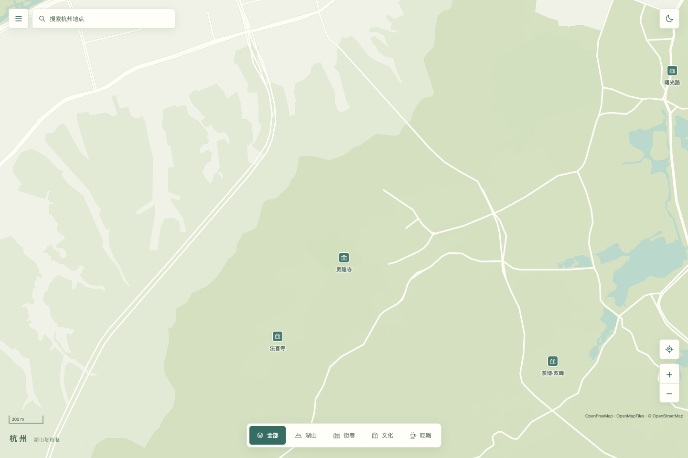
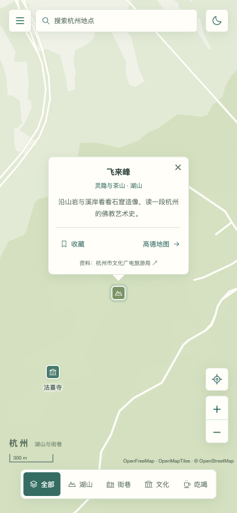

# 地图设计 · Map Design Skill

用于城市文旅、街区导览与校园地图的 Codex skill，提炼自 [杭州慢游](https://hainahuang729.github.io/hangzhou-slow-walk/) 的设计与交互方式。

地图占据主画面，信息保持精简；缩小时优先展示附近更有代表性的地点，放大后逐步展开。城市配色按当地气质重新选择。

## 适用场景

- 以真实地图为核心的城市旅游、街区探索和校园导览。
- 全屏地图、紧凑浮动控件、浅深主题与手机布局。
- 地标优先的标记避让、完整搜索、短介绍、收藏和地点分享。
- 已有地图的视觉与交互整理，同时保留原地点 ID、收藏和分享链接。

本仓库提供设计方法与可复用资源，不包含完整地图应用或实时旅游数据库。游戏地图、插画地图和静态地理分析不在本技能范围内。

## 安装与使用

技能目录为 [`map-design/`](map-design/)，包含 `SKILL.md` 及其全部相对引用。安装时保留整个目录；也可以向支持技能安装的 Codex 发出请求：

```text
请安装 GitHub 仓库 HainaHuang729/map-design-skill 中的 map-design 技能。
```

安装后示例：

```text
使用 $map-design，为苏州设计一张精简的文旅地图。
以地图为主，配色体现当地气质；缩小时重叠的地点只显示更有代表性的那个。
```

```text
使用 $map-design，整理现有校园导览地图的手机布局和标记避让。
保留已有地点 ID、收藏与分享链接。
```

阅读入口：[技能说明](map-design/SKILL.md) · [设计参数](map-design/references/design-system.md) · [实现约定](map-design/references/implementation.md)。

## 参考效果

这些截图来自杭州慢游的早期设计快照，用于说明布局、颜色和信息密度。





地图署名：OpenFreeMap · OpenMapTiles · © OpenStreetMap contributors。地理数据采用 ODbL，详见 [来源说明](NOTICE.md)。

## 更多城市参考

新增4座城市、8张参考图。每城选6处地点，桌面图（1440×900）展示整体布局，手机图（390×844）展示地点介绍。上海采用夜色，其余采用浅色；所有示例均支持浅深切换。

| 苏州 · 园林与水巷 | 上海 · 江岸与街区 |
| --- | --- |
|  |  |
| [查看手机图](map-design/assets/cities/suzhou-mobile.png) · 粉墙灰白、水巷青、竹绿 | [查看手机图](map-design/assets/cities/shanghai-mobile.png) · 江岸夜蓝、深水蓝、暖灯色 |
| **成都 · 茶馆与街巷** | **厦门 · 海岸与老城** |
|  |  |
| [查看手机图](map-design/assets/cities/chengdu-mobile.png) · 茶纸色、公园绿、茶绿 | [查看手机图](map-design/assets/cities/xiamen-mobile.png) · 沙色、海蓝、海岸青 |

[查看全部参考图与配色说明](map-design/references/city-examples.md)。这些是设计示例，点位为OSM代表位置；坐标和来源见 [`data.js`](examples/city-maps/data.js)。

### 本地打开互动示例

在仓库根目录运行：

```sh
python3 -m http.server 8080 --bind 127.0.0.1
```

打开 [城市地图示例](http://127.0.0.1:8080/examples/city-maps/?city=suzhou)，可切换城市、主题与分类，搜索全部点位并缩放地图。页面使用仓库内的MapLibre运行时，底图需要联网；不需要安装前端依赖或构建。

## 包含的资源

| 文件 | 用途 |
| --- | --- |
| `map-design/SKILL.md` | 技能入口、适用范围和关键交互规则 |
| `map-design/agents/openai.yaml` | 技能显示名称与默认提示 |
| `map-design/references/design-system.md` | 布局、颜色、尺寸与参考截图 |
| `map-design/references/implementation.md` | 点位数据、标签避让、状态和部署约定 |
| `map-design/references/city-examples.md`、`map-design/assets/cities/` | 4城配色说明及8张桌面/手机参考图 |
| `map-design/assets/select-visible-places.mjs` | 按编辑优先级和屏幕距离选择可见地点 |
| `map-design/assets/map-tokens.css` | 可按城市调整的浅深主题配色变量 |
| `examples/city-maps/`、`examples/vendor/` | 可复现参考图的互动示例、地图运行时与第三方许可 |

## 许可与来源

原创说明、样式和示例代码采用 [MIT License](LICENSE)。地图截图所含第三方地理内容保留其署名与许可，参见 [NOTICE.md](NOTICE.md)。

参考应用源码：[HainaHuang729/hangzhou-slow-walk](https://github.com/HainaHuang729/hangzhou-slow-walk)。
