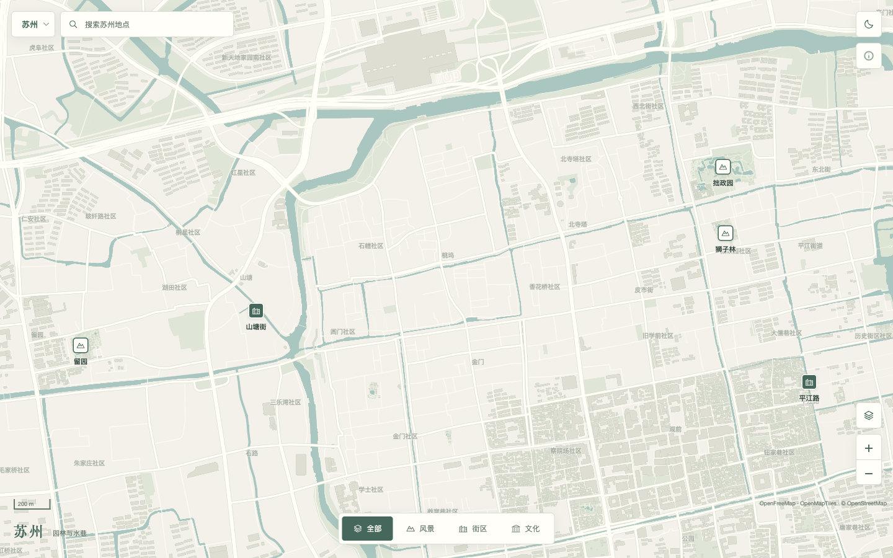
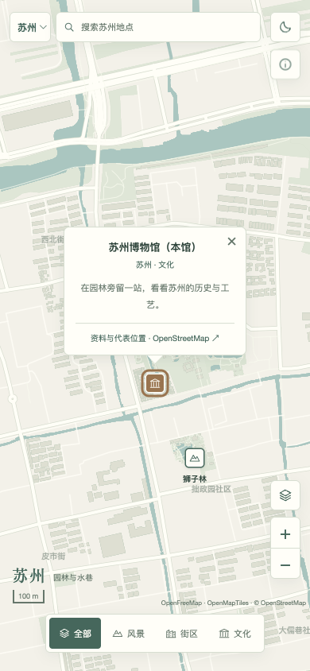
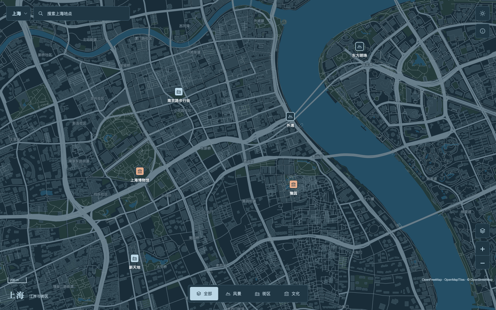
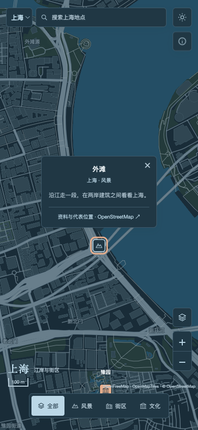
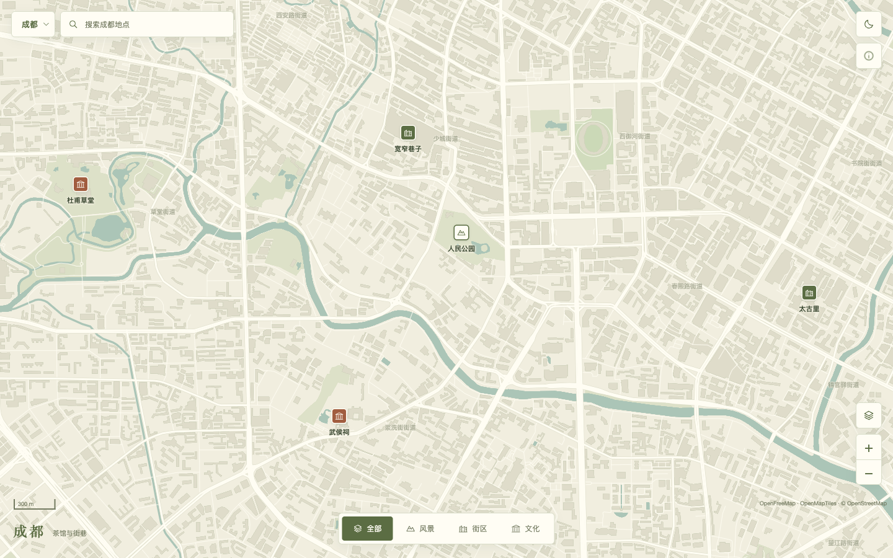
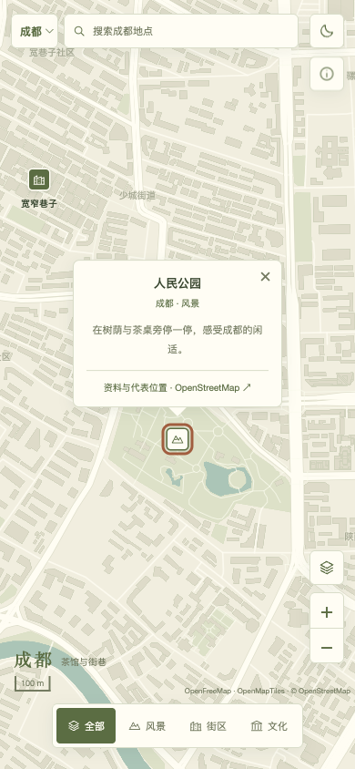
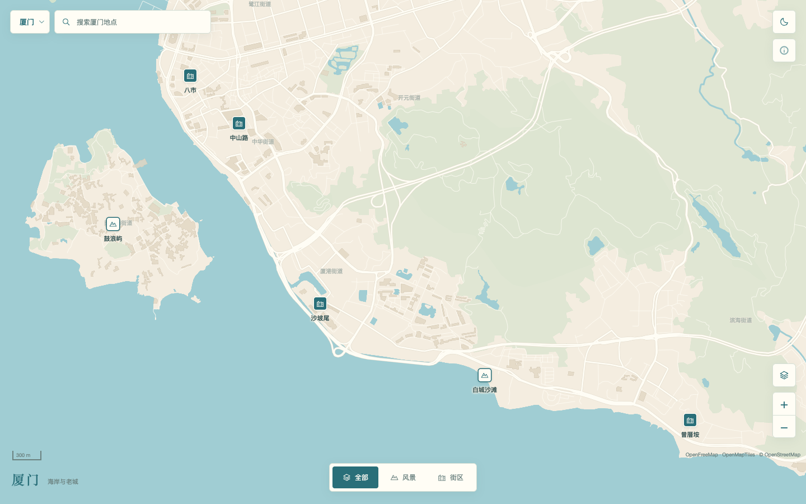
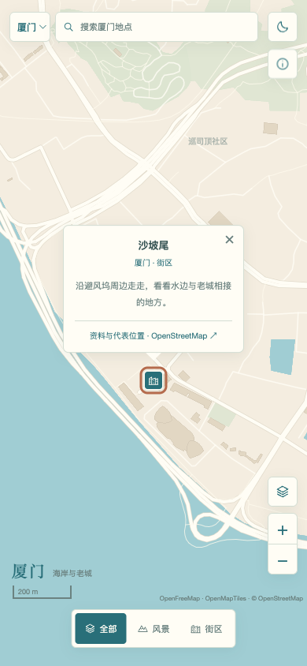

# 四座城市的简洁参考图

这组参考图展示同一套地图骨架如何适配不同城市。每城仅选6处地点，使用真实底图和WGS84代表位置，不构成完整旅游指南。点位核对于2026年10月26日。

| 城市 | 参考配色 | 重点观察 |
| --- | --- | --- |
| 苏州 | 粉墙灰白 `#f3f1e9`、水巷青 `#aac6c0`、竹绿 `#46675c` | 园林附近的密集点位，缩小时按编辑优先级收起 |
| 上海 | 江岸夜蓝 `#192c38`、深水蓝 `#244e65`、暖灯色 `#e7af8e` | 深色底图、建筑轮廓、跨江空间与轻量控件 |
| 成都 | 茶纸色 `#f1eedf`、公园绿 `#c9d8b5`、茶绿 `#5b6d43` | 街巷与公园的关系，以及近邻地点的避让 |
| 厦门 | 沙色 `#f4ede0`、海蓝 `#a0cdd3`、海岸青 `#296f79` | 海岸与岛屿的轮廓，以及陆地、水面的颜色对比 |

这些颜色是编辑设计选择，不是城市官方色。浅深两种配色均可在示例中切换；截图采用苏州、成都、厦门的浅色和上海的深色。

## 桌面与手机

### 苏州

### 上海

### 成都

### 厦门

## 如何使用

借鉴布局关系、地图色彩与信息密度。制作新城市地图时，重新核对地点、坐标与显示优先级；不要直接照搬本示例的6个点位或地图范围。

完整仓库包含可复现这些截图的 `examples/city-maps/` 源码，支持城市切换、浅深模式、地点分类、完整搜索、缩放避让与短介绍气泡。该目录位于技能包之外，安装技能本身并不需要地图运行时。

地图与点位数据包含 OpenStreetMap 内容，采用 ODbL。截图保留 OpenFreeMap / OpenMapTiles / OpenStreetMap 署名；复用时也应保留。源码中的 MapLibre GL JS 保留其 BSD-3-Clause 及捆绑代码许可。
